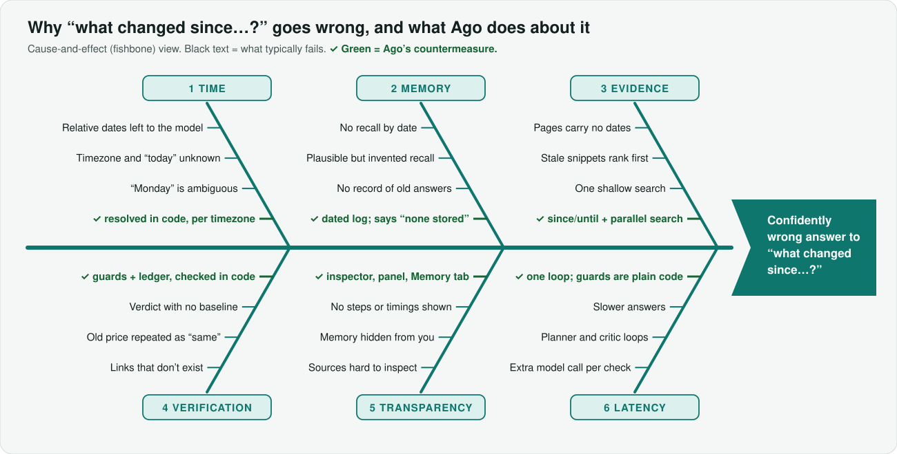
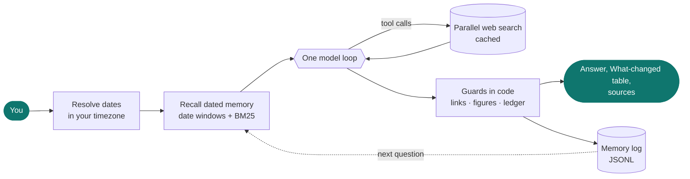
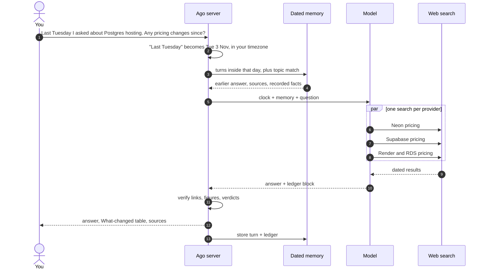
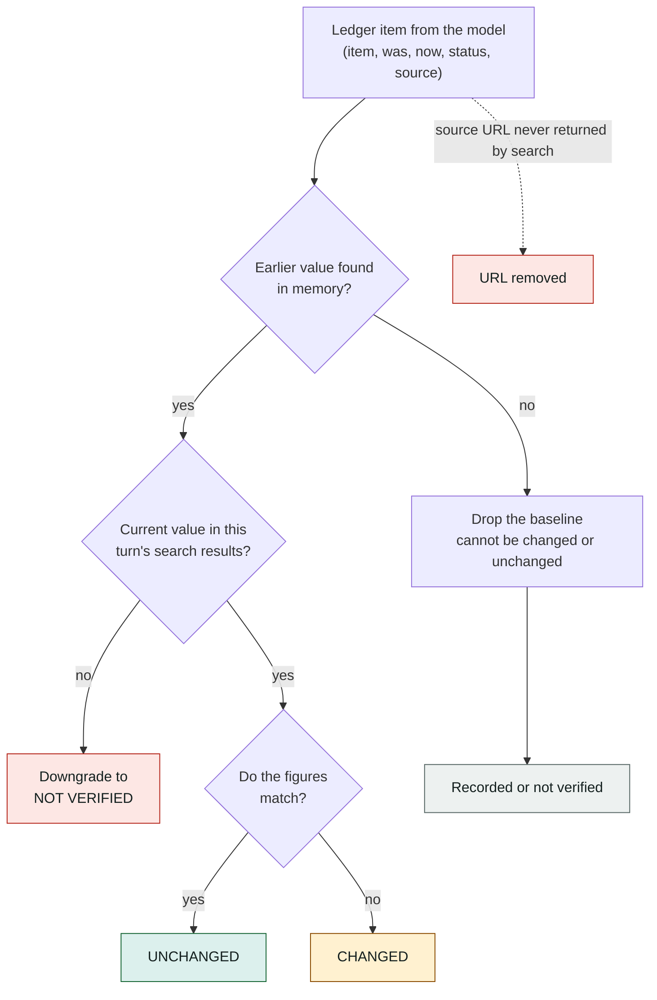
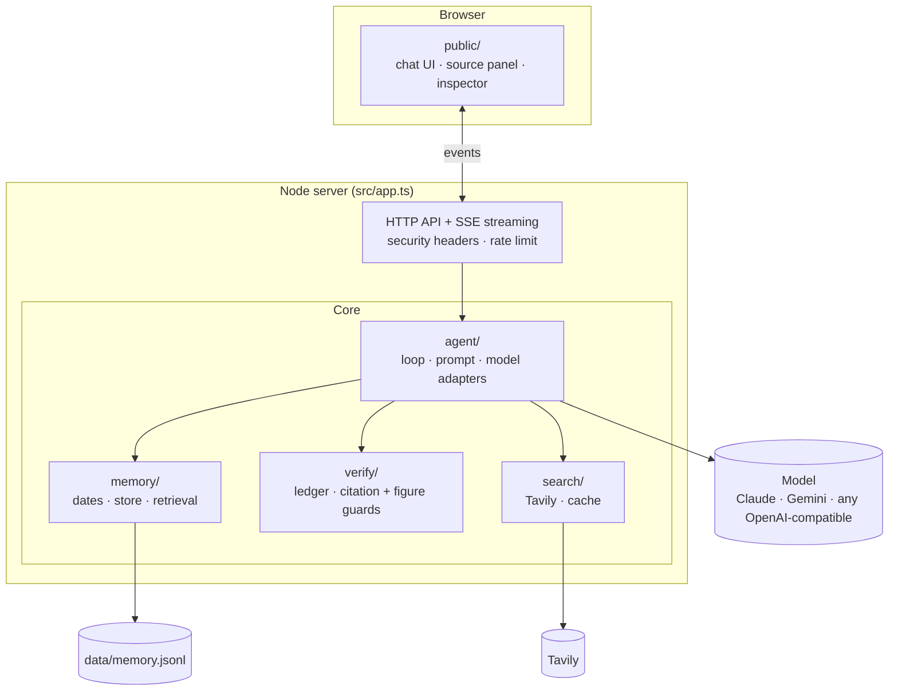

<div align="center">

# Ago

**Search that remembers when.**

A chat assistant with exactly one tool, web search, and a dated memory of everything you've asked.
It answers fast, cites what it found, and tells you what changed since you last asked.

[](https://github.com/krish57-bit/ago/actions/workflows/ci.yml)


[Quick start](#quick-start) · [How it works](#how-it-works) · [Architecture](#architecture) · [Configuration](#configuration) · [Design doc](DESIGN.md)

</div>

> *"Last Tuesday I asked you about Postgres hosting. Has any pricing changed since then?"*
>
> Ago resolves **last Tuesday** to an exact date in your timezone, recalls that conversation, re-checks each provider against live sources in parallel, and answers with a table of what changed, what didn't, and what it couldn't verify. Code checks every verdict before you see it.

---

## The problem

Questions about *time* are where chat assistants quietly fail. They have to do calendar maths, recall a conversation from days ago, and decide whether an old number is still true, and they do all of it inside the model, with nothing checking the result.

<p align="center">
  
</p>

Ago's answer is to **take those jobs away from the model** and give them to plain code that can be tested.

## How it works



1. **Dates are resolved in code.** "Monday", "3 November" and "last week" become exact windows in your timezone *before* the model runs.
2. **Memory is recalled in code.** Turns inside those windows, plus topical matches, are injected with absolute timestamps, the earlier answer, its sources and the facts it recorded. If nothing is stored for that day, the prompt says so, so the model doesn't improvise.
3. **One model loop, one tool.** The model decides what to search, and independent searches run in parallel. No router, planner or critic, so the only latency is the model and the search itself.
4. **Guards run in code.** Links and figures must come from this turn's search results, and every verdict in the claim ledger is checked against its evidence. These are plain functions with tests, not another model call.

### One question, end to end



### Why a verdict can't outrun its evidence

After each answer the model appends a small structured **claim ledger** (item, earlier value, current value, status, source) in the same call. Ago then adjudicates every row:



If the model says "unchanged" but the numbers differ, code corrects it to "changed" and the UI shows *Label corrected by code*.

## What you get

| | |
|---|---|
| **Dated memory** | Every exchange is stored with its time, sources and facts. Browse by day, re-verify any answer with **Still correct?**, **Forget** it, or export everything as JSON. |
| **What changed** | A table per answer: earlier value → current value, status, source link, and a note when code overrode the model. |
| **Grounded answers** | Publisher-named citation chips, a sources side panel with publication dates (or an explicit "date unknown"), and flags for any link or figure not found in this turn's results. |
| **Inspector** | Per-answer trace: memory lookup, each model step with first-token time, and every parallel search with its latency. |
| **Real-product basics** | Streaming with a Stop button, light and dark themes (every text pair meets WCAG AA contrast), keyboard shortcuts, mobile layout, screen-reader-friendly streaming. |

## Quick start

Requires Node 20.6 or newer.

```bash
npm install
cp .env.example .env      # add a model key and a Tavily key
npm run dev               # http://localhost:3000
```

You need two keys (see [`.env.example`](.env.example)):

- **A model:** `ANTHROPIC_API_KEY`, *or* any OpenAI-compatible API. Google Gemini's free tier works: set `LLM_PROVIDER=openai`, `LLM_API_KEY`, `LLM_BASE_URL`, `MODEL`.
- **Search:** `TAVILY_API_KEY` (the free tier is enough).

**Try the memory features on day one:** click **Add sample history** on the start screen. It loads three past chats dated relative to today. Then ask:

- *On Monday we shortlisted 5 CRM tools for a 20-person sales team. Has any of them changed pricing or shipped something big since?*
- *Last Tuesday I asked you about Postgres hosting. Has any pricing changed since then?*
- *What did I ask you on 3 November? Is your answer still correct today?*

## Architecture



The model and the search backend are each behind a small interface, so tests run fully offline with a scripted model and a mock search.

```
ago/
├── src/
│   ├── server.ts            process entrypoint: wiring, logging, graceful shutdown
│   ├── app.ts               HTTP app factory: security headers, rate limit, API routes
│   ├── config.ts            environment configuration
│   ├── types.ts             shared types
│   ├── agent/               the loop (agent.ts), prompt + tool schema, model adapters
│   ├── memory/              date resolution, retrieval (date windows + BM25), JSONL store
│   ├── search/              Tavily provider, TTL cache, mock provider
│   ├── verify/              claim ledger adjudication, citation and figure guards
│   ├── lib/                 logger, rate limiter
│   └── public/              the UI: index.html, app.css, app.js (no build step)
├── scripts/                 eval.ts (live eval), seed.ts (sample data)
├── test/                    offline tests with a scripted model and mock search
├── docs/img/                diagrams used in this README
├── DESIGN.md                design decisions and what was rejected
└── .github/workflows/       CI: typecheck + tests on every push
```

## Configuration

| Variable | Default | Purpose |
|---|---|---|
| `ANTHROPIC_API_KEY` | | Anthropic model (default provider). |
| `LLM_PROVIDER`, `LLM_API_KEY`, `LLM_BASE_URL` | `anthropic` | Use any OpenAI-compatible provider instead (Gemini, Groq, OpenRouter, Ollama, ...). |
| `MODEL` | `claude-sonnet-5-5` | Model id. Comma-separate several for a **fallback chain**, useful on free tiers with per-model daily quotas. |
| `REASONING_EFFORT` | unset | `low` makes Gemini much faster. Leave unset for providers that reject it. |
| `TAVILY_API_KEY` | | Search backend. `SEARCH_PROVIDER=mock` runs without it. |
| `PORT`, `DEFAULT_TIMEZONE`, `DATA_DIR` | `3000`, system, `data` | Server basics. The browser's timezone is used when available. |
| `RATE_LIMIT_PER_MIN` | `20` | Chat requests per client per minute (`0` disables). |
| `LOG_LEVEL`, `LOG_FORMAT` | `info`, `pretty` | `silent` mutes logs; `json` gives structured logs. |

## Development

```bash
npm run check     # typecheck + 40 offline tests (no API keys needed)
npm test          # tests only
npm run eval      # live eval of the example question shapes: behaviour, grounding, latency
```

`npm run eval -- crm` runs a single case. Evals use real keys and your free-tier quota. Their checks are deterministic (behaviour, grounding, latency), not judged by another model.

### API

| Endpoint | Purpose |
|---|---|
| `POST /api/chat` | `{message, conversationId?, tz?}`. Streams Server-Sent Events: `memory`, `status`, `text`, `reset`, `tool`, `step`, `sources`, `ledger`, `done`, `error`. |
| `GET /api/history?conversationId=` | Turns of a conversation, with sources and ledger. |
| `GET /api/memory`, `GET /api/export` | Everything remembered, as a list or a JSON download. |
| `GET /api/conversations` | Conversation list. |
| `DELETE /api/conversations/:id`, `DELETE /api/turns/:id` | Delete a conversation or a single remembered turn. |
| `POST /api/sample`, `POST /api/seed` | Load sample history, or import turns with explicit timestamps. |
| `GET /api/health` | Version, model, and any missing configuration. |

Setting `ALLOW_CLOCK_OVERRIDE=1` lets a client send `{"now": "<ISO>"}` to `/api/chat` to simulate a different "today" (used for evals).

## Data and security

- **Everything stays local.** Memory is an append-only JSONL file at `data/memory.jsonl` (git-ignored). Ago sends your questions to the model and search providers you configure, and nowhere else.
- You can see, export and delete everything from the UI. There is no hidden profile.
- The server sends a strict Content-Security-Policy (no inline scripts), rejects cross-origin writes, limits request size, and rate-limits chat. The prompt treats search results as untrusted data.
- Ago is a single-user local app with **no authentication**, so don't expose it to the internet as it is.

## Troubleshooting

| Symptom | Fix |
|---|---|
| `Port 3000 is already in use` | Another copy is running. Stop it, or run `PORT=3001 npm run dev`. |
| `429` / "quota exceeded" from Gemini | Free keys have a small per-model daily limit. Add fallbacks: `MODEL=gemini-3.5-flash,gemini-flash-lite-latest`. |
| `401` from Anthropic | The key must start with `sk-ant-`, and the account needs credit. |
| Banner says a key is missing | Edit `.env` and restart. `.env` is read once at startup. |

## License

[MIT](LICENSE)
